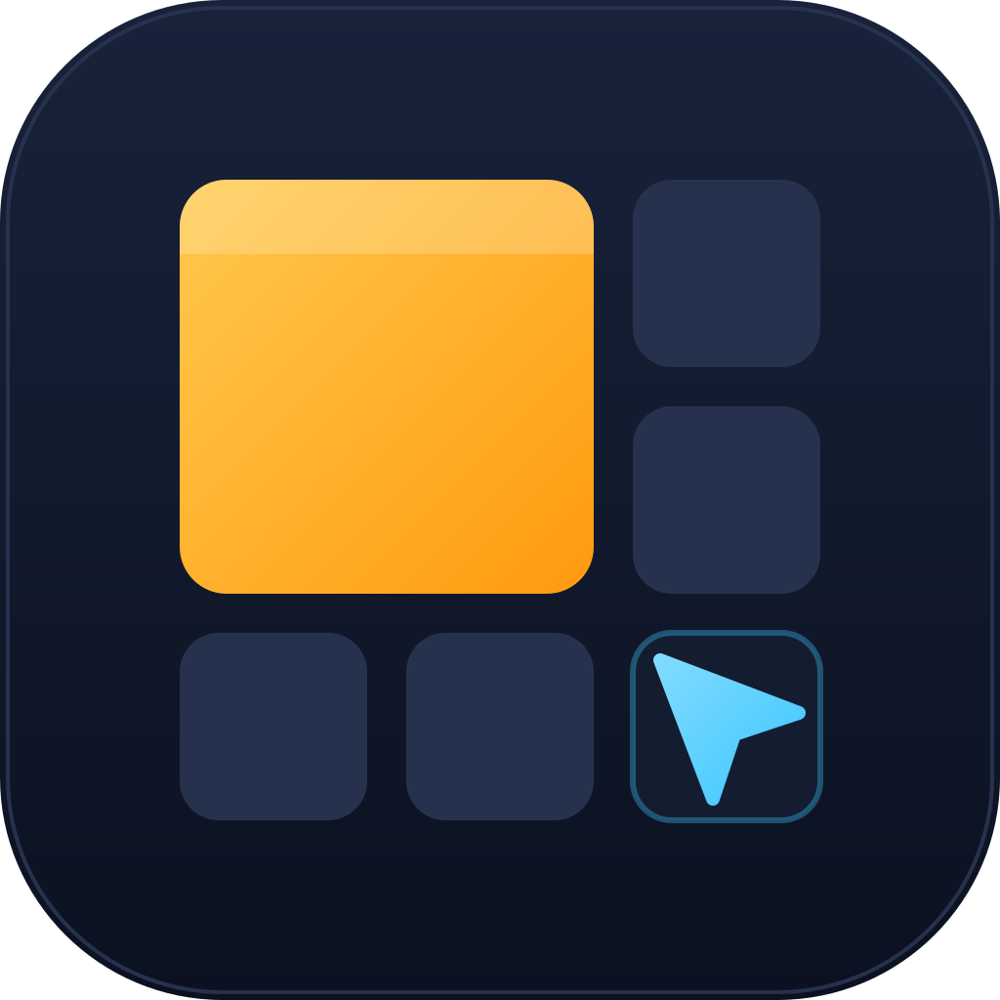

<p align="center">
  
</p>
<h1 align="center">GridPilot</h1>
<p align="center"><b>Divvy's grid. Omarchy's tiling. One cockpit.</b><br>
A window manager for macOS, built as a framework so new behaviours are just new features.</p>

---

GridPilot starts out like [Divvy](https://mizage.com/divvy/): press `mod+space`,
drag across a grid, and the window snaps there. Named shortcuts put windows
on your favourite regions, and pressing one again sends the window to the
next display.

When you want more, press `mod+l` and the workspace becomes an
[Omarchy](https://github.com/basecamp/omarchy)/Hyprland-style tiler (dwindle, scrolling
columns or master/stack), with directional focus and swap, ten workspaces,
a scratchpad, tabbed groups, pop-out windows and a key cheat sheet on
`mod+k`.

It doesn't need SIP disabled, Spaces or anything beyond the Accessibility
permission.

## Quick start

Needs Rust 1.82 or newer (`rustup update`). Cargo checks this and stops with
`rustc X is not supported ... requires rustc 1.82` on an older toolchain.

```sh
cargo build --release -p gridpilot
./target/release/gridpilot init      # writes ~/.config/gridpilot/gridpilot.toml
./target/release/gridpilot run       # menu bar app; grant Accessibility when asked
```

Or build a proper app bundle with `scripts/bundle-macos.sh`.

Talk to the running instance from a terminal or script:

```sh
gridpilot grid shortcut "Left half"
gridpilot layout dwindle
gridpilot move-to-workspace 3 --silent
gridpilot windows
```

No Mac handy? `gridpilot simulate` runs the real engine against a fake desktop with two displays.

## Default keys (abridged)

`mod` is a **Hyper key**, Omarchy's SUPER: map Caps Lock to `ctrl+alt+cmd` (no Shift) with
Hyperkey, Raycast or Karabiner, see [docs/HYPER.md](docs/HYPER.md). No Hyper key? Press `ctrl+alt+cmd`,
or set `mod = "ctrl+alt"`. `grid` = `ctrl+cmd`. Remap either one in `[modifiers]`.

| Keys | Action |
|---|---|
| `mod+space` | Grid overlay (drag, arrows, ⇧ extend, ⌥ subdivide, ⏎ apply) |
| `grid+←/→/↑/↓`, `grid+return`, `grid+1..5`, `grid+u/i/j/k` | Halves, maximize, thirds, quarters (press again: next display) |
| `mod+←↑→↓` / `mod+shift+←↑→↓` | Focus / swap |
| `mod+1..0` / `mod+shift+1..0` | Workspace / move window there |
| `mod+tab`, `mod+backslash` | Next / former workspace |
| `mod+l` | Cycle layout: dwindle → scrolling → master → floating |
| `mod+t`, `mod+f`, `mod+o` | Float, fullscreen, pop out (float + pin + centre) |
| `mod+s`, `mod+shift+s` | Scratchpad toggle / send |
| `mod+g`, `mod+[` / `mod+]` | Group toggle / previous, next tab |
| `mod+-` / `mod+=` | Resize |
| `mod+k` | All keys |

Full list: [docs/KEYS.md](docs/KEYS.md).

## Configuration

Run `gridpilot settings`, or pick **Settings…** from the menu bar icon. That opens a settings page
in your browser where you can record shortcuts, draw grid regions, and pick layouts, gaps, themes,
window rules and features. Saving writes the config file (keeping the old one as `.bak`) and
GridPilot reloads it straight away.

Everything lives in `~/.config/gridpilot/gridpilot.toml`, which you can also edit by hand; see the
annotated [reference config](config/gridpilot.toml). Highlights:

```toml
[tiling]
default_layout = "floating"   # Divvy; "dwindle" for Omarchy-style auto-tiling

[grid]
size = "6x4"
cycle_displays = true

[[grid.shortcut]]
name = "Code + docs"
keys = "grid+8"
cells = "0,0 4x4 / 6x4"

[workspaces]
layout = { "2" = "dwindle", "3" = "scrolling" }

[[rule]]
app = "com.apple.systempreferences"
float = true

[features]
disabled = ["groups"]
```

## How it's built

```
crates/gridpilot-core    engine, grid, layouts, workspaces, commands, features (pure Rust, tested anywhere)
crates/gridpilot-macos   Accessibility + Carbon hotkeys + AppKit overlay
crates/gridpilot         daemon + CLI
```

Every behaviour is a `Feature` that registers commands, key bindings,
layouts and event hooks. Keys, the CLI, the menu and the overlay all speak
one command language (`focus left`, `grid apply 0,0 3x4 / 6x4`), and window
frames are computed from a model and then applied, so features compose
without knowing about each other.

* [docs/RESEARCH.md](docs/RESEARCH.md): how Divvy and Omarchy work, what macOS allows, and the design decisions that follow
* [docs/ARCHITECTURE.md](docs/ARCHITECTURE.md): data flow, and how to add a feature, layout or backend
* [docs/ROADMAP.md](docs/ROADMAP.md): what's next
* [docs/HYPER.md](docs/HYPER.md): setting up Caps Lock as the Hyper key
* [docs/BRAND.md](docs/BRAND.md): logo, palette and voice

## Status

0.1: the core is covered by unit and end-to-end tests. The macOS backend
type-checks against the Apple targets and CI builds it on a macOS runner,
but it has not yet been run on a real Mac. Expect rough edges until it has
(see the roadmap).

MIT licensed.
